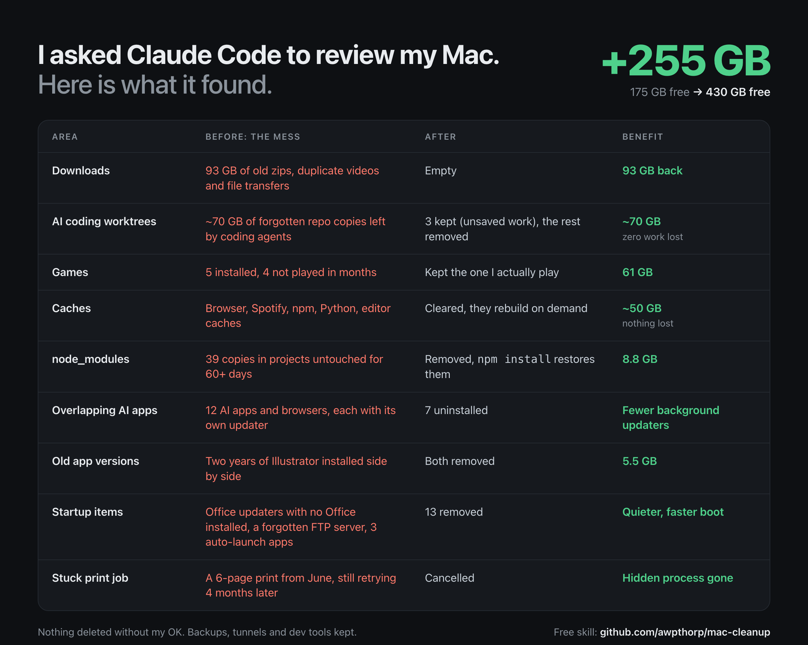

# mac-cleanup

A free skill for Claude Code (and other agents that support skills) that reviews a slow or full Mac and cleans it up safely.

It audits first, explains everything in plain English, and **deletes nothing until you say yes**, category by category.



## What it checks

- **Disk space**: Downloads, Trash, large old files, iPhone backups, Mail attachments, APFS snapshots
- **Caches**: browsers, Spotify, Slack, updater leftovers, Homebrew, logs
- **Developer junk**: stale `node_modules`, npm/pnpm/yarn/bun/uv/pip caches, Xcode DerivedData and simulators, Docker/Colima/OrbStack, Rust/Go/Gradle/Maven, local AI models
- **AI coding agent leftovers**: forgotten worktrees from Codex, Cursor, Claude Code and Grok, checked for uncommitted work before anything is touched
- **Startup and background items**: login items, launch agents and daemons, orphaned updaters from apps you already deleted, forgotten servers
- **Apps**: biggest apps with last-used dates, overlapping apps (five browsers, six AI chat apps), old versions installed side by side
- **Why it is slow right now**: CPU hogs, Spotlight indexing, backup jobs at login, stuck print jobs

## How it works

1. **Audit (read-only)**: bundled scripts gather everything. Nothing is changed.
2. **Report**: a ranked list with sizes, what each thing is, and whether it comes back on its own.
3. **You choose**: safe-now items, items that need a yes, and things it recommends you keep (backups, tunnels, toolchains).
4. **Clean up**: only what you approved, user-level first, then one reviewed admin script via the normal macOS password dialog.
5. **Before/after summary** with real numbers measured from free space.

## Install

```bash
npx skills add awpthorp/mac-cleanup
```

Or copy `skills/mac-cleanup` into `~/.claude/skills/`.

Then just ask something like:

> my mac is really slow and storage is almost full, can you review it?

## Safety

- The bundled scripts in `skills/mac-cleanup/scripts/` are read-only. Read them first; they are short.
- Git worktrees are only removed when they have no uncommitted changes, no unpushed commits, and their commit exists on a branch.
- System folders, the Photos library, the Mail store, Keychains and cloud-synced files are off limits unless you explicitly ask.
- You stay in control: every deletion needs your approval, and the skill tells you what it is about to do.

Use at your own risk. Back up anything you care about before a big cleanup.

## License

MIT
